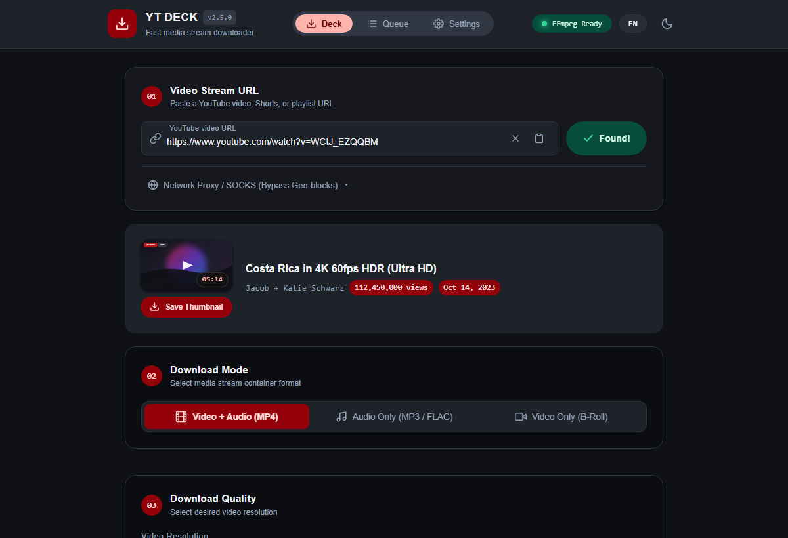
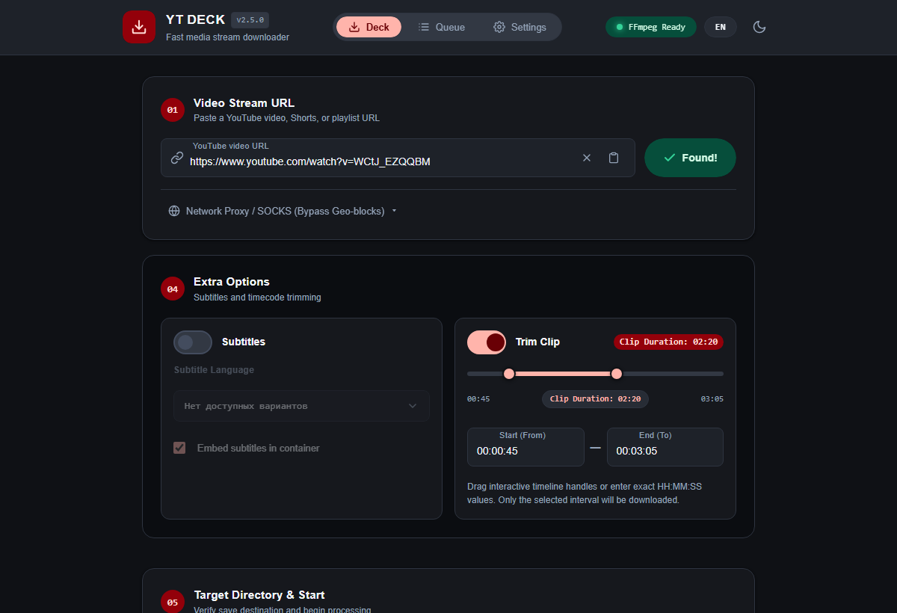
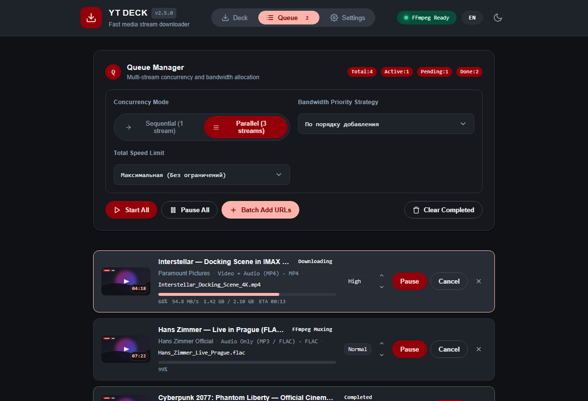
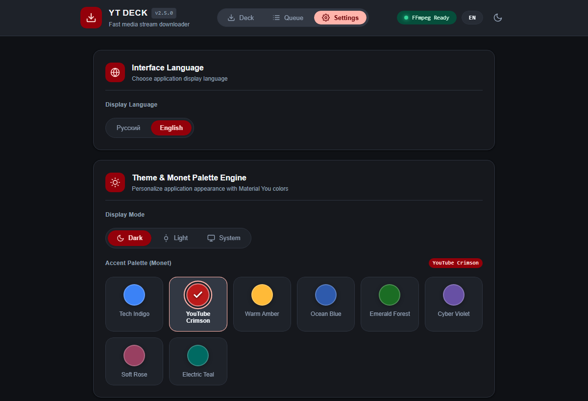

# YT Deck

<p align="center">
  <strong>Modern desktop YouTube downloader powered by yt-dlp, FFmpeg, and Google Material Design 3.</strong>
</p>

<p align="center">
  <a href="README.md">English</a> | <a href="README_RU.md">Русский</a>
</p>

<p align="center">
  <a href="https://github.com/skaywhay/ytapp/releases"></a>
  <a href="https://github.com/skaywhay/ytapp/releases"></a>
  <a href="https://github.com/skaywhay/ytapp/actions/workflows/release.yml"></a>
  <a href="https://m3.material.io"></a>
  <a href="https://m3.material.io/styles/color/the-color-system/tokens"></a>
  <a href="https://github.com/yt-dlp/yt-dlp"></a>
  <a href="https://www.python.org/"></a>
  <a href="LICENSE"></a>
</p>

<p align="center">
  
</p>

---

## Overview

**YT Deck** is a lightweight, responsive Windows desktop application for downloading and processing YouTube media streams. It combines the power of **yt-dlp** and **FFmpeg** with a desktop interface built around **Google Material Design 3 (M3 Expressive)** and the **Monet dynamic color engine**.

Unlike standard command-line wrappers or outdated GUI utilities, YT Deck delivers a smooth native desktop experience via Microsoft Edge WebView2, supporting multi-language audio dubs, up to 4K/8K IMAX resolutions, automatic timecode trimming, queue management, and modern network resilience with Chrome TLS fingerprint impersonation.

---

## Comparison Matrix

| Feature | YT Deck | 4K Video Downloader | Web Services (Cobalt / SaveFrom) |
| :--- | :--- | :--- | :--- |
| **Ads & Tracking** | None (0% telemetry, clean open-source) | Commercial popups and upsell banners | Aggressive ads, popups, and redirects |
| **Quality Limits** | Up to 8K / 60fps / HDR / IMAX | Restricted in free tier | Often capped at 720p or 1080p |
| **Multi-Language Audio Dubs** | Full automatic scan and selection | Rare / unsupported | Unsupported |
| **Lossless Timecode Trimming** | Built-in interactive frame slider | Unsupported | Unsupported |
| **Download Limits** | Unlimited local batch queue | Capped at 30 downloads per day | Server-side throttling and queues |
| **Underlying Engine** | Open-source yt-dlp + FFmpeg | Proprietary closed runtime | Third-party proxy servers |

---

## Visual Showcase & Features

### Interactive Timecode Trimming
Lossless precision trimming before download starts. Drag start/end handles or enter exact HH:MM:SS timestamps to fetch only the requested portion, bypassing multi-gigabyte container downloads.

<p align="center">
  
</p>

### Queue Manager & Bandwidth Orchestration
Concurrent stream downloads with real-time speed metrics, remaining size counters, dynamic ETA, and per-item priority scheduling (High / Normal / Low).

<p align="center">
  
</p>

### Material You & Monet Palette Personalization
Built on Google Material Design 3 guidelines with 7 accent palettes (YouTube Crimson, Sunset Amber, Ocean Azure, Emerald Forest, Electric Violet, Sunset Rose, and Mint Teal) and full Dark / Light / System theme support.

<p align="center">
  
</p>

### Material Design 3 & Monet Engine
- **M3 Navigation Rail / Tabs**: Seamless switching between the primary Deck workspace, Queue Manager, and Settings view.
- **7 Dynamic Monet Accent Palettes**: YouTube Crimson, Sunset Amber, Ocean Azure, Emerald Forest, Electric Violet, Sunset Rose, and Mint Teal.
- **System Theme Synchronization**: Dynamic switching between Dark, Light, and System modes with WCAG AA compliant contrast ratios and tonal surface elevation.
- **Custom Blur Dropdowns**: Hardware-accelerated acrylic dropdown selectors with custom badge metadata indicators.

### Download & Media Engine
- **Accurate Stream Selection**: Real-time resolution detection supporting standard (1080p, 720p), ultrawide, and cinematic IMAX aspect ratios (3840x2024 4K, 7680x4048 8K, AV1, VP9, H.264).
- **Multi-Track Audio Dubs**: Automatic detection and extraction of alternate language dub tracks (e.g., multi-language creator tracks) with auto-preference settings.
- **Three Core Modes**:
  - **Video + Audio**: Merged container output (`MP4`, `MKV`, `WEBM`).
  - **Video Only**: Direct video stream extraction for editing and B-roll.
  - **Audio Only**: High-fidelity sound extraction (`MP3`, `M4A`, `OPUS`, `FLAC`, `WAV`).
- **Timecode Trimming**: Local lossless trimming with sub-second precision via FFmpeg post-processing.
- **Playlist Management**: Batch URL ingestion with range limits and individual format overrides.

### Network Performance & Anti-Throttling
- **Chrome TLS Impersonation**: Built-in `curl_cffi` client fingerprint matching to eliminate ISP connection drops, handshake timeouts, and CDN speed throttling.
- **QuickJS Challenge Solver**: Bundled QuickJS interpreter (`bin/qjs.exe`) for automated YouTube player challenge solving without stalls.
- **Dual-State Realtime Feedback**: WebSocket event stream supplemented by a background polling mechanism ensuring uninterrupted progress and bandwidth reporting.

---

## Tech Stack

- **Backend**: Python 3.10+, Flask, Flask-SocketIO, Simple-WebSocket
- **Engine**: yt-dlp, FFmpeg, curl-cffi, QuickJS
- **Frontend**: Vanilla JavaScript (ES6+), Modern CSS3 Tokens, Material Design 3 Expressive
- **Desktop Runtime**: PyWebView (Microsoft Edge WebView2)
- **Packaging**: PyInstaller

---

## Quick Start

### Windows

#### Option 1: Modern Material Design 3 Installer (Recommended)
1. Download `YT_Deck_Setup.exe` from [Releases](https://github.com/skaywhay/ytapp/releases).
2. Run the installer to configure installation directory, desktop shortcut, start menu entry, and system registration.
3. Launch YT Deck from Desktop or Start Menu.

#### Option 2: Portable Executable
1. Download `YT_Deck-windows-portable.exe` from [Releases](https://github.com/skaywhay/ytapp/releases).
2. Place `ffmpeg.exe` in the same directory or ensure it is installed in system `PATH`.
3. Run the executable directly without installation.

---

### macOS & Linux

#### Running from Source (Quick Setup)
1. Clone the repository:
   ```bash
   git clone https://github.com/skaywhay/ytapp.git
   cd ytapp
   ```
2. Make the startup script executable and run it:
   ```bash
   chmod +x run.sh
   ./run.sh
   ```
   The script checks system dependencies, creates a virtual environment, installs packages, and launches the desktop app.

#### Pre-built Binaries
- **macOS**: Download `YT_Deck-macOS.zip` from [Releases](https://github.com/skaywhay/ytapp/releases), unpack `YT_Deck.app` into `/Applications`.
- **Linux**: Download `YT_Deck-linux-x86_64.tar.gz` from [Releases](https://github.com/skaywhay/ytapp/releases), extract and run `./YT_Deck`.

---

## Manual Installation (All Platforms)

```bash
# 1. Create and activate a virtual environment
python3 -m venv .venv
source .venv/bin/activate  # On Windows: .venv\Scripts\activate

# 2. Install dependencies
pip install -r requirements.txt

# 3. Start desktop application
python server.py

# Optional: Run as browser web-service
python server.py --browser
```

---

## Building Executables

### Windows Portable Executable
```cmd
build_exe.bat
```

### Windows Material Design 3 Installer
```cmd
build_installer.bat
```

### macOS Application Bundle
```bash
python3 -m PyInstaller --clean -y yt_deck.spec
# Output will be generated in dist/YT_Deck.app
```

### Linux Standalone Executable
```bash
python3 -m PyInstaller --clean -y yt_deck.spec
# Output will be generated in dist/YT_Deck
```

---

## System Requirements

- **Windows**: Windows 10 / 11 (64-bit), Microsoft Edge WebView2.
- **macOS**: macOS 11 Big Sur or newer.
- **Linux**: Ubuntu 20.04+, Debian 11+, Fedora, Arch Linux with `libwebkit2gtk-4.1` (or `4.0`) installed:
  ```bash
  # Debian / Ubuntu / Mint
  sudo apt install libwebkit2gtk-4.1-dev ffmpeg

  # Arch Linux / Manjaro
  sudo pacman -S webkit2gtk ffmpeg

  # Fedora
  sudo dnf install webkit2gtk4.1 ffmpeg
  ```
- **FFmpeg**: Required on all platforms for merging video and audio streams (`ffmpeg` in `PATH`).

---

## Project Structure

```text
ytapp/
├── server.py               # Application entry point: WebView2 / Flask server
├── api/                    # REST endpoints (/api/probe, /api/download) & Socket.IO handlers
├── core/                   # Engine abstraction, configuration, queue dispatcher
├── services/               # Background services (media trimming, updater)
├── picker.py               # Native Windows directory selection bridge
├── icon.ico                # Application icon
├── yt_deck.spec            # PyInstaller build specification
├── build_exe.bat           # Automated single-click build script
├── run.bat                 # Development auto-setup and launch script
├── requirements.txt        # Python dependency manifest
├── templates/
│   └── index.html          # Semantic Material Design 3 user interface
└── static/
    ├── css/
    │   └── style.css       # M3 design tokens, Monet color schemes, responsive layout
    └── js/
        └── app.js          # Client controller, Socket.IO listeners, Monet engine
```

---

## Windows SmartScreen & Security Verification

When launching `YT_Deck_Setup.exe` or `YT_Deck-windows-portable.exe` on Windows for the first time, Microsoft Defender SmartScreen may display a warning dialog (`Windows protected your PC`).

### Why this happens
This occurs because YT Deck is a free, open-source project and does not use an expensive commercial EV code-signing certificate (which costs hundreds of dollars annually).

### How to proceed
1. Click **More info** on the SmartScreen dialog.
2. Click **Run anyway**.

### Verification
All releases are compiled completely transparently via public GitHub Actions workflows. You can verify the integrity of any downloaded binary by comparing its SHA-256 hash against `SHA256SUMS.txt` published on the [Releases](https://github.com/skaywhay/ytapp/releases) page:

```cmd
certutil -hashfile YT_Deck_Setup.exe SHA256
```

---

## License & Disclaimer

Distributed freely for personal and educational use. This software is an interface utility for `yt-dlp` and `ffmpeg`. All copyrights and intellectual property regarding downloaded content belong to their respective creators and copyright owners.
