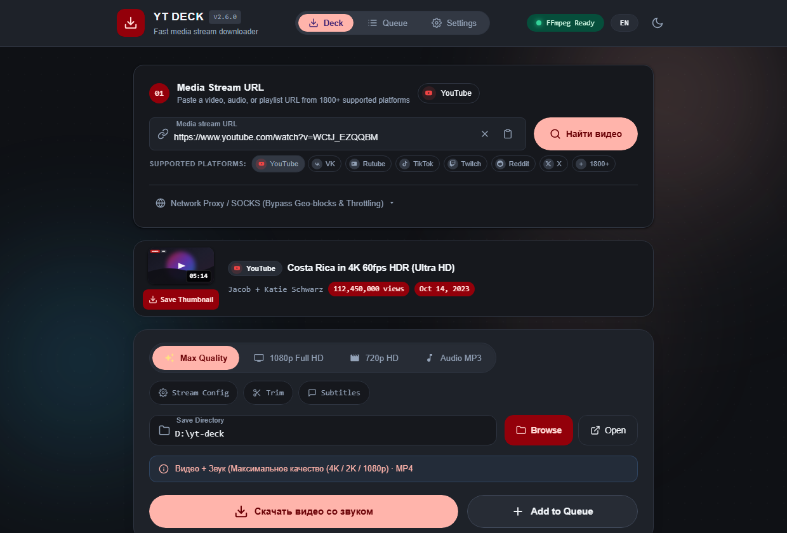
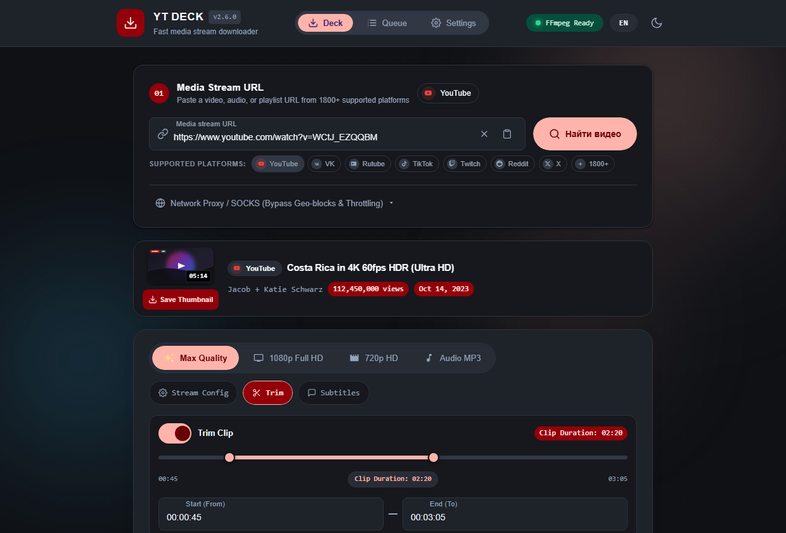
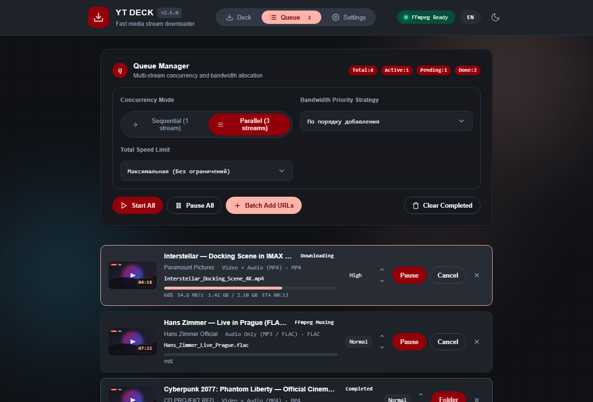
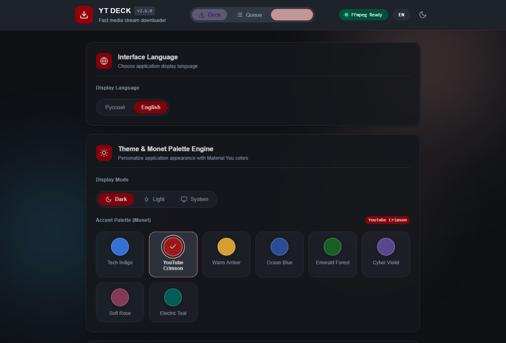

# YT Deck

<p align="center">
  <strong>Universal media downloader & stream processor for 1800+ platforms, powered by yt-dlp, FFmpeg, and Google Material Design 3 (Material You).</strong>
</p>

<p align="center">
  <a href="README.md">English</a> | <a href="README_RU.md">Русский</a>
</p>

<p align="center">
  <a href="https://github.com/skaywhay/ytapp/releases"></a>
  <a href="https://github.com/skaywhay/ytapp/releases"></a>
  <a href="https://github.com/skaywhay/ytapp/actions/workflows/release.yml"></a>
  <a href="https://m3.material.io"></a>
  <a href="https://m3.material.io/styles/color/the-color-system/tokens"></a>
  <a href="https://github.com/yt-dlp/yt-dlp"></a>
  <a href="https://www.python.org/"></a>
  <a href="LICENSE"></a>
</p>

<p align="center">
  
</p>

---

## Overview

**YT Deck** is a high-performance Windows desktop application designed to download, convert, and process media streams from over **1800+ supported platforms** — including YouTube, VK Video, Rutube, TikTok, Twitch, Reddit, X (Twitter), Vimeo, and SoundCloud.

Engineered with **yt-dlp** and **FFmpeg**, YT Deck runs inside a responsive native Microsoft Edge WebView2 runtime. It brings a refined **Google Material Design 3 (Material You / Expressive)** design system with dynamic Monet color palettes, ambient decorative shapes, byte-range network trimming, and an interactive queue manager.

---

## What's New in v2.6.0

* **Universal Media Engine (1800+ Sites):** Automatic platform detection with live vector Assist Chips for YouTube, VK Video, Rutube, TikTok, Twitch, Reddit, X, Vimeo, SoundCloud, and 1000+ others.
* **Intelligent Stream Selector:** Differentiates split DASH streams (video without audio + audio) from unified progressive MP4 and HLS (m3u8) streams to prevent unnecessary re-encoding cycles.
* **Byte-Range Trimming (HTTP Range):** When trimming fragments, YT Deck requests only the selected timecode byte slices from the server, saving gigabytes of bandwidth and minutes of download time.
* **Realtime FFmpeg Feedback:** Live parsing of FFmpeg `-progress pipe:1` eliminating stalls and giving precise transcoding timecodes.
* **M3 Expressive Redesign:** Floating ambient Monet orbs, geometric depth patterns, continuous segmented button controls, and harmonized 48px/52px touch targets.
* **Security Hardening:** Strict release domain whitelisting, SHA-256 executable integrity validation, WebSocket origin restrictions, and automatic shadow cookie cleanup.

---

## Comparison Matrix

| Feature | YT Deck v2.6.0 | 4K Video Downloader | Web Services (Cobalt / SaveFrom) |
| :--- | :--- | :--- | :--- |
| **Supported Platforms** | **1800+ (YouTube, VK, Rutube, TikTok, Twitch, etc.)** | YouTube & limited popular sites | Limited / unstable |
| **Ads & Telemetry** | **None (0% telemetry, clean open-source)** | Commercial popups and upsell banners | Aggressive ads, popups, and redirects |
| **Quality Limits** | **Up to 8K / 60fps / HDR / IMAX** | Restricted in free tier | Often capped at 720p or 1080p |
| **Multi-Language Audio Dubs** | **Full automatic scan and selection** | Rare / unsupported | Unsupported |
| **True Byte-Range Trimming** | **Built-in interactive range downloader** | Unsupported | Unsupported |
| **Download Limits** | **Unlimited local batch queue** | Capped at 30 downloads per day | Server-side throttling and queues |
| **Underlying Engine** | **Open-source yt-dlp + FFmpeg** | Proprietary closed runtime | Third-party proxy servers |

---

## Visual Showcase & Features

### Interactive Timecode Trimming
Lossless precision trimming before download starts. Drag start/end handles or enter exact HH:MM:SS timestamps to fetch only the requested portion via HTTP byte ranges.

<p align="center">
  
</p>

### Queue Manager & Bandwidth Orchestration
Concurrent stream downloads with real-time speed metrics, remaining size counters, dynamic ETA, and per-item priority scheduling (High / Normal / Low).

<p align="center">
  
</p>

### Material You & Monet Palette Personalization
Built on Google Material Design 3 guidelines with 7 accent palettes (YouTube Crimson, Sunset Amber, Ocean Azure, Emerald Forest, Electric Violet, Sunset Rose, and Mint Teal) with full Dark / Light / System theme support.

<p align="center">
  
</p>

---

## Core Capabilities

### Material Design 3 & Monet Engine
- **M3 Navigation Rail / Tabs**: Instant navigation between the primary Deck workspace, Queue Manager, and Settings view.
- **7 Dynamic Monet Accent Palettes**: YouTube Crimson, Sunset Amber, Ocean Azure, Emerald Forest, Electric Violet, Sunset Rose, and Mint Teal.
- **Ambient Decorative Shapes**: Subtle blurred gradient orbs with gentle floating animations and geometric dot grid depth.
- **System Theme Synchronization**: Dynamic switching between Dark, Light, and System modes with WCAG AA compliant contrast ratios.

### Media Engine & Stream Processing
- **1800+ Platforms**: Universal extraction with instant visual feedback and dynamic assist chips.
- **Accurate Stream Selection**: Real-time resolution detection supporting standard (1080p, 720p), ultrawide, and cinematic IMAX aspect ratios (4K, 8K, AV1, VP9, H.264).
- **Multi-Track Audio Dubs**: Automatic detection and extraction of alternate language dub tracks with auto-preference settings.
- **Three Core Modes**:
  - **Video + Audio**: Merged container output (`MP4`, `MKV`, `WEBM`).
  - **Video Only**: Direct video stream extraction for editing and B-roll.
  - **Audio Only**: High-fidelity sound extraction (`MP3`, `M4A`, `OPUS`, `FLAC`, `WAV`).
- **Subtitles & Chapters**: Extract or embed multi-language subtitle tracks directly into video containers.

### Network Performance & Anti-Throttling
- **Chrome TLS Impersonation**: Built-in `curl_cffi` client fingerprint matching to eliminate ISP connection drops, handshake timeouts, and CDN speed throttling.
- **QuickJS Challenge Solver**: Bundled QuickJS interpreter (`bin/qjs.exe`) for automated player challenge solving without stalls.
- **Proxy / SOCKS Support**: Integrated proxy accordion for routing traffic through SOCKS5 or HTTP proxies.

---

## Tech Stack

- **Backend**: Python 3.10+, Flask, Flask-SocketIO, Simple-WebSocket
- **Engine**: yt-dlp, FFmpeg, curl-cffi, QuickJS
- **Frontend**: Vanilla JavaScript (ES6+), Modern CSS3 Tokens, Material Design 3 Expressive
- **Desktop Runtime**: PyWebView (Microsoft Edge WebView2)

---

## Installation & Setup

### Option 1: Standalone Installer (Recommended)
Download `YT_Deck_Setup.exe` from the [Latest Releases](https://github.com/skaywhay/ytapp/releases) page and run the setup wizard.

### Option 2: Run from Source

1. **Clone the repository:**
   ```bash
   git clone https://github.com/skaywhay/ytapp.git
   cd ytapp
   ```

2. **Create and activate a virtual environment:**
   ```bash
   python -m venv .venv
   .venv\Scripts\activate
   ```

3. **Install dependencies:**
   ```bash
   pip install -r requirements.txt
   ```

4. **Run the desktop client:**
   ```bash
   python server.py
   ```

---

## Building Executables

### Standalone Executable
```bash
python -m PyInstaller --clean -y yt_deck.spec
```

### Setup Installer
```bash
cd installer
python -m PyInstaller --clean -y installer.spec
```

---

## License

This project is licensed under the MIT License — see the [LICENSE](LICENSE) file for details.
All brand trademarks belong to their respective copyright holders.
