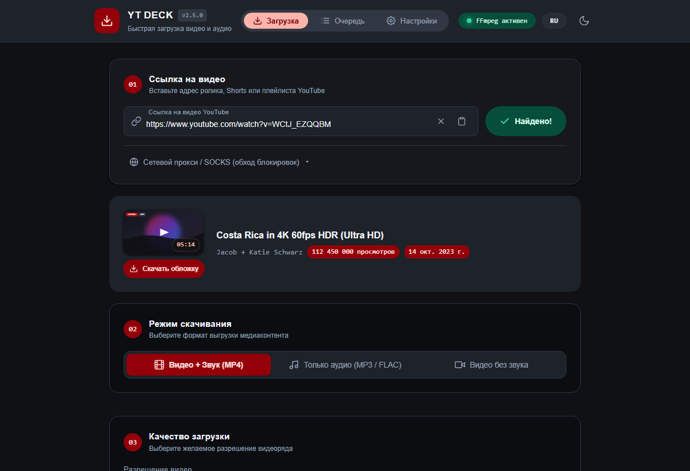
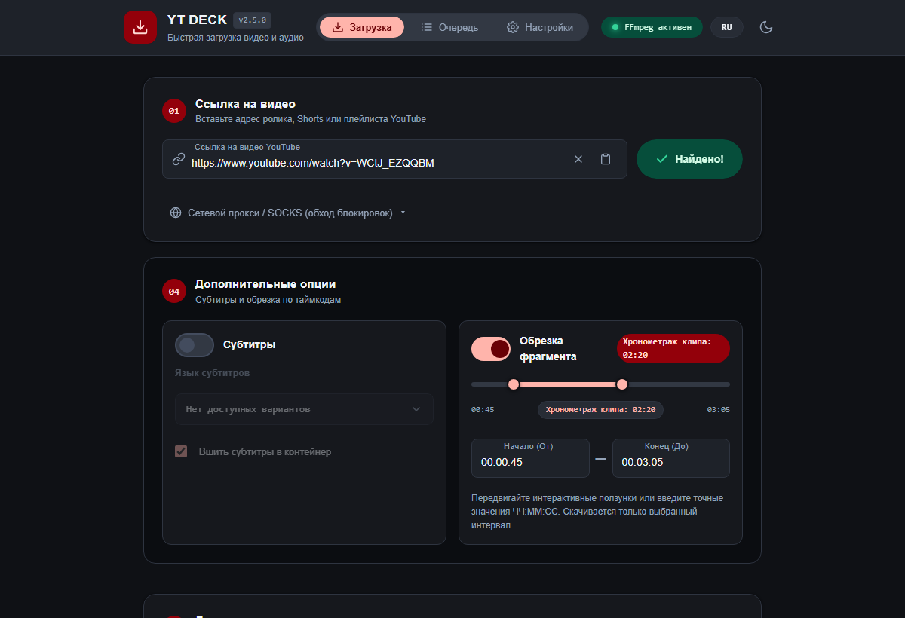
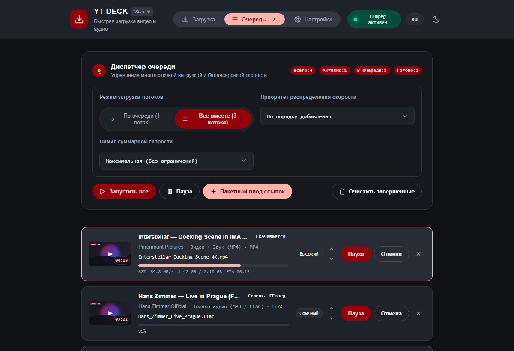
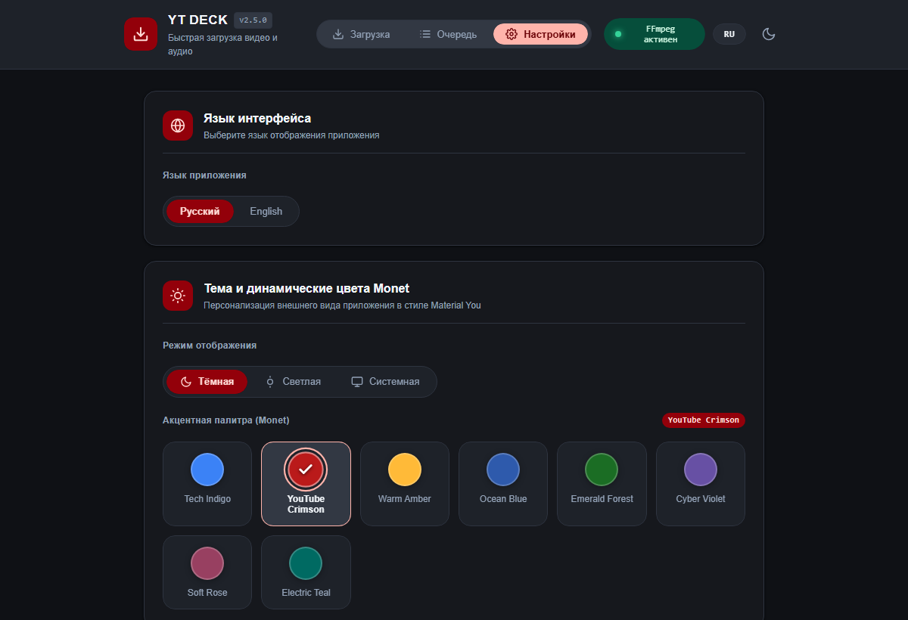

# YT Deck

<p align="center">
  <strong>Современное настольное приложение для загрузки и обработки медиа с YouTube на базе yt-dlp, FFmpeg и Google Material Design 3.</strong>
</p>

<p align="center">
  <a href="README.md">English</a> | <a href="README_RU.md">Русский</a>
</p>

<p align="center">
  <a href="https://github.com/skaywhay/ytapp/releases"></a>
  <a href="https://github.com/skaywhay/ytapp/releases"></a>
  <a href="https://github.com/skaywhay/ytapp/actions/workflows/release.yml"></a>
  <a href="https://m3.material.io"></a>
  <a href="https://m3.material.io/styles/color/the-color-system/tokens"></a>
  <a href="https://github.com/yt-dlp/yt-dlp"></a>
  <a href="https://www.python.org/"></a>
  <a href="LICENSE"></a>
</p>

<p align="center">
  
</p>

---

## Обзор

**YT Deck** — быстрое и отзывчивое Windows-приложение для скачивания и конвертации видео и аудио с YouTube. Проект объединяет возможности **yt-dlp** и **FFmpeg** с интерфейсом, спроектированным по канонам дизайн-системы **Google Material Design 3 (M3 Expressive)** с поддержкой динамических палитр **Monet**.

Приложение работает в нативном контейнере Microsoft Edge WebView2 без консольных окон и стороннего оверхеда, поддерживает выбор мультиязычных дубляжей, форматы до 4K/8K IMAX, точную обрезку по таймкодам, параллельную очередь задач и обход сетевых ограничений через имитацию TLS-отпечатка Chrome.

---

## Сравнение с альтернативами

| Возможность | YT Deck | 4K Video Downloader | Веб-сервисы (Cobalt / SaveFrom) |
| :--- | :--- | :--- | :--- |
| **Реклама и спам** | Нет (0% телеметрии, чистый Open Source) | Навязчивые баннеры и платные апсейлы | Агрессивная реклама, попапы и редиректы |
| **Ограничения качества** | До 8K / 60fps / HDR / IMAX | Ограничено в бесплатной версии | Часто ограничено до 720p или 1080p |
| **Мультиязычный дубляж** | Полное сканирование и выбор дорожек | Редко / не поддерживается | Не поддерживается |
| **Покадровая обрезка** | Встроенный интерактивный таймлайн-слайдер | Не поддерживается | Не поддерживается |
| **Лимиты скачиваний** | Безлимитная локальная очередь | Лимит 30 скачиваний в сутки | Троттлинг серверов и очереди ожидания |
| **Движок под капотом** | Открытый локальный yt-dlp + FFmpeg | Закрытый проприетарный модуль | Сторонние прокси-серверы |

---

## Визуальный обзор и ключевые возможности

### Интерактивная обрезка по таймкодам
Локальная обрезка фрагментов без потерь качества до начала полной загрузки. Передвигайте маркеры начала и конца или введите точный диапазон ЧЧ:ММ:СС — приложение выкачает только нужный отрезок, экономя гигабайты трафика.

<p align="center">
  
</p>

### Диспетчер очереди и приоритизация потоков
Параллельная или последовательная загрузка с отображением реальной скорости (МБ/с), таймера ETA, скачанного объёма и распределением приоритетов (Высокий / Обычный / Низкий).

<p align="center">
  
</p>

### Персонализация Material You и палитры Monet
Интерфейс адаптирован под рекомендации Google Material Design 3 с 7 динамическими акцентными палитрами (YouTube Crimson, Sunset Amber, Ocean Azure, Emerald Forest, Electric Violet, Sunset Rose и Mint Teal), а также поддержкой Тёмной, Светлой и Автоматической системной тем.

<p align="center">
  
</p>

---

## Возможности

### Material Design 3 и палитры Monet
- **M3 Navigation Rail / Tabs**: Быстрое переключение между основным экраном Deck, менеджером очереди и разделом настроек.
- **7 динамических акцентных палитр Monet**: YouTube Crimson, Sunset Amber, Ocean Azure, Emerald Forest, Electric Violet, Sunset Rose и Mint Teal.
- **Синхронизация тем**: Тёмная, Светлая и Системная темы с поддержкой тонального возвышения поверхностей и контрастности по стандарту WCAG AA.
- **Кастомные выпадающие списки**: Выпадающие селекторы с акриловым размытием фона и бейджами метаданных (разрешение, битрейт, размер).

### Медиадвижок и загрузка
- **Точное определение разрешений**: Корректное распознавание стандартных (1080p, 720p), широкоформатных и кинематографических соотношений IMAX (3840x2024 4K, 7680x4048 8K, кодеки AV1, VP9, H.264).
- **Мультиязычные аудиодорожки**: Автоматическое сканирование и выбор альтернативных дубляжей видео (включая мультиязычные каналы) с приоритетом оригинального или русского трека.
- **Три основных режима**:
  - **Видео + Звук**: Склейка в контейнеры `MP4`, `MKV`, `WEBM`.
  - **Только видео**: Прямое извлечение видеопотока без звука (B-roll, видеомонтаж).
  - **Только аудио**: Извлечение звука высокой чёткости (`MP3`, `M4A`, `OPUS`, `FLAC`, `WAV`).
- **Обрезка по таймкодам**: Локальная обрезка фрагментов видео без потерь качества через FFmpeg.
- **Поддержка плейлистов**: Пакетная загрузка списков ссылок с указанием диапазона и индивидуальных настроек.

### Сетевая оптимизация и обход троттлинга
- **Имитация TLS-отпечатка Chrome**: Использование `curl_cffi` для предотвращения обрывов SSL-хэндшейка, сброса соединений и занижения скорости провайдерами и CDN.
- **Интегрированный QuickJS**: Встроенный легковесный движок QuickJS (`bin/qjs.exe`) для фонового решения JS-вызовов YouTube плеера.
- **Двухканальный мониторинг**: Сокет-поток дополнен резервным фоновым поллингом, что исключает зависание статус-бара при задержках пакетов.

---

## Стек технологий

- **Бэкенд**: Python 3.10+, Flask, Flask-SocketIO, Simple-WebSocket
- **Ядро**: yt-dlp, FFmpeg, curl-cffi, QuickJS
- **Фронтенд**: Vanilla JavaScript (ES6+), Modern CSS3 Tokens, Material Design 3 Expressive
- **Среда выполнения**: PyWebView (Microsoft Edge WebView2)
- **Сборка**: PyInstaller

---

## Быстрый старт

### Windows

#### Вариант 1. Инсталлятор в стиле Material Design 3 (Рекомендуется)
1. Скачайте `YT_Deck_Setup.exe` из раздела [Releases](https://github.com/skaywhay/ytapp/releases).
2. Запустите установщик: выберите папку установки, создание ярлыков на рабочем столе и в меню «Пуск», а также регистрацию в системе.
3. Запустите YT Deck с рабочего стола или из меню «Пуск».

#### Вариант 2. Портативная версия (Portable)
1. Скачайте `YT_Deck-windows-portable.exe` из раздела [Releases](https://github.com/skaywhay/ytapp/releases).
2. Убедитесь, что `ffmpeg.exe` находится рядом с файлом программы или добавлен в системную переменную `PATH`.
3. Запустите файл напрямую без установки.

---

### macOS и Linux

#### Запуск из исходного кода (Быстрый старт)
1. Клонируйте репозиторий:
   ```bash
   git clone https://github.com/skaywhay/ytapp.git
   cd ytapp
   ```
2. Сделайте скрипт исполняемым и запустите его:
   ```bash
   chmod +x run.sh
   ./run.sh
   ```
   Скрипт проверит окружение, создаст `.venv`, установит зависимости и откроет десктопное окно приложения.

#### Готовые сборки
- **macOS**: Скачайте архив `YT_Deck-macOS.zip` из [Releases](https://github.com/skaywhay/ytapp/releases) и переместите `YT_Deck.app` в папку «Программы» (`/Applications`).
- **Linux**: Скачайте `YT_Deck-linux-x86_64.tar.gz` из [Releases](https://github.com/skaywhay/ytapp/releases), распакуйте и запустите исполняемый файл `./YT_Deck`.

---

## Ручная установка (Все платформы)

```bash
# 1. Создание и активация виртуального окружения
python3 -m venv .venv
source .venv/bin/activate  # На Windows: .venv\Scripts\activate

# 2. Установка зависимостей
pip install -r requirements.txt

# 3. Запуск десктопного приложения
python server.py

# Опционально: Запуск в режиме веб-интерфейса для обычного браузера
python server.py --browser
```

---

## Сборка исполняемых файлов

### Windows Portable .EXE
```cmd
build_exe.bat
```

### Windows Графический Инсталлятор (Setup)
```cmd
build_installer.bat
```

### macOS Application Bundle (.app)
```bash
python3 -m PyInstaller --clean -y yt_deck.spec
# Готовое приложение будет скомпилировано в dist/YT_Deck.app
```

### Linux Standalone Executable
```bash
python3 -m PyInstaller --clean -y yt_deck.spec
# Исполняемый файл появится в dist/YT_Deck
```

---

## Системные требования

- **Windows**: Windows 10 / 11 (64-бит), Microsoft Edge WebView2.
- **macOS**: macOS 11 Big Sur или новее.
- **Linux**: Ubuntu 20.04+, Debian 11+, Fedora, Arch Linux с установленной библиотекой `libwebkit2gtk-4.1` (или `4.0`):
  ```bash
  # Debian / Ubuntu / Mint
  sudo apt install libwebkit2gtk-4.1-dev ffmpeg

  # Arch Linux / Manjaro
  sudo pacman -S webkit2gtk ffmpeg

  # Fedora
  sudo dnf install webkit2gtk4.1 ffmpeg
  ```
- **FFmpeg**: Необходим на всех платформах для склейки видео и звука (`ffmpeg` в системном `PATH`).

---

## Архитектура проекта

```text
ytapp/
├── server.py               # Точка входа: запуск WebView2 / веб-сервера Flask
├── api/                    # Маршруты API (/api/probe, /api/download) и сокет-события
├── core/                   # Конфигурация, движок yt-dlp, многопоточная очередь
├── services/               # Вспомогательные сервисы (обрезка таймкодов, автоапдейтер)
├── picker.py               # Мост для нативного выбора папок Windows
├── icon.ico                # Иконка приложения
├── yt_deck.spec            # Спецификация сборки PyInstaller
├── build_exe.bat           # Скрипт сборки в один клик
├── run.bat                 # Скрипт автоустановки и быстрого запуска в dev-режиме
├── requirements.txt        # Список зависимостей Python
├── templates/
│   └── index.html          # Разметка в стиле Material Design 3
└── static/
    ├── css/
    │   └── style.css       # Дизайн-токены M3, палитры Monet, адаптивная верстка
    └── js/
        └── app.js          # Логика клиента, Socket.IO обработчики, движок тем Monet
```

---

## Предупреждение Windows SmartScreen и проверка безопасности

При первом запуске `YT_Deck_Setup.exe` или `YT_Deck-windows-portable.exe` встроенный защитник Windows SmartScreen может показать синий диалог с предупреждением: «Система Windows защитила ваш компьютер».

### Почему это происходит
YT Deck — бесплатный проект с открытым исходным кодом. Он распространяется свободно и не использует коммерческий платный сертификат подписи кода (EV Code Signing Certificate), стоимость которого составляет сотни долларов в год.

### Как запустить приложение
1. В появившемся окне защитника нажмите ссылку **Подробнее**.
2. Нажмите кнопку **Выполнить в любом случае**.

### Проверка подлинности (SHA-256)
Все бинарные файлы собираются автоматически и публично через сервис GitHub Actions. Вы всегда можете сверить контрольную сумму скачанного файла с таблицей хэшей `SHA256SUMS.txt`, опубликованной на странице [Релизов](https://github.com/skaywhay/ytapp/releases):

```cmd
certutil -hashfile YT_Deck_Setup.exe SHA256
```

---

## Лицензия и отказ от ответственности

Программное обеспечение распространяется свободно для личного и образовательного использования. Данный проект является графической оболочкой для утилит `yt-dlp` и `ffmpeg`. Все авторские права на скачиваемый медиаконтент принадлежат их законным правообладателям.
