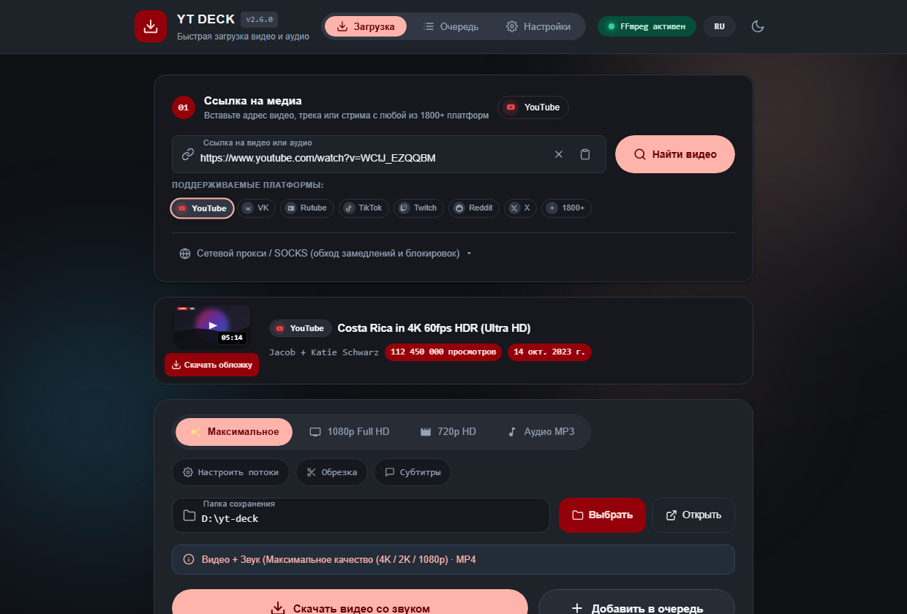
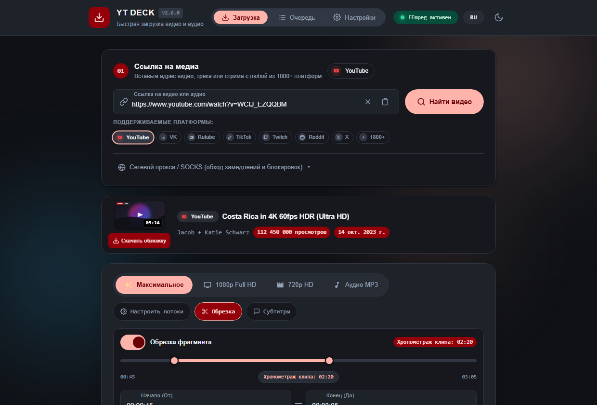
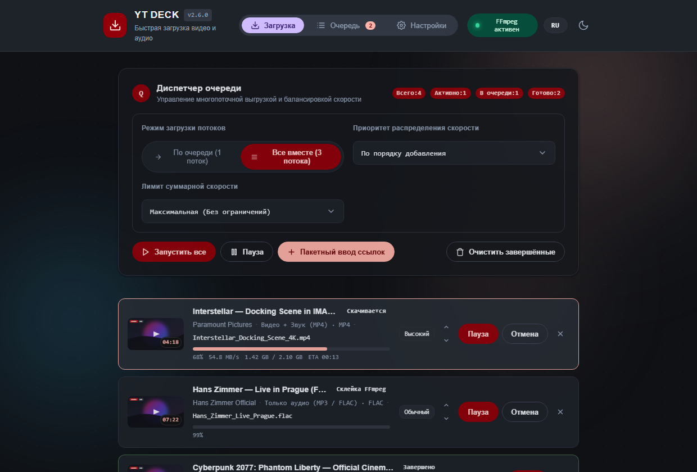
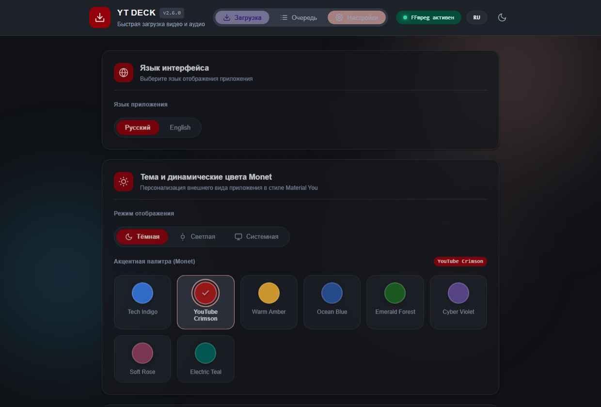

# YT Deck

<p align="center">
  <strong>Универсальный медиа-комбайн для загрузки и обработки видео/аудио с 1800+ платформ на базе yt-dlp, FFmpeg и Google Material Design 3 (Material You).</strong>
</p>

<p align="center">
  <a href="README.md">English</a> | <a href="README_RU.md">Русский</a>
</p>

<p align="center">
  <a href="https://github.com/skaywhay/ytapp/releases"></a>
  <a href="https://github.com/skaywhay/ytapp/releases"></a>
  <a href="https://github.com/skaywhay/ytapp/actions/workflows/release.yml"></a>
  <a href="https://m3.material.io"></a>
  <a href="https://m3.material.io/styles/color/the-color-system/tokens"></a>
  <a href="https://github.com/yt-dlp/yt-dlp"></a>
  <a href="https://www.python.org/"></a>
  <a href="LICENSE"></a>
</p>

<p align="center">
  
</p>

---

## Обзор

**YT Deck** — быстрое, надёжное и отзывчивое Windows-приложение для скачивания, конвертации и обработки медиапотоков с более чем **1800+ платформ** — включая YouTube, VK Видео, Rutube, TikTok, Twitch, Reddit, X (Twitter), Vimeo и SoundCloud.

Приложение построено на базе **yt-dlp** и **FFmpeg** в нативном контейнере Microsoft Edge WebView2. Интерфейс выполнен в премиальном стиле **Google Material Design 3 (Material You / Expressive)** с динамическими палитрами Monet, атмосферными фоновыми фигурами, точной диапазонной загрузкой фрагментов и диспетчером очереди.

---

## Что нового в версии 2.6.0

* **Мультиплатформенность (1800+ сервисов):** Автоматическое определение источника ссылки и динамические M3 Assist Chips с векторными логотипами (YouTube, VK Видео, Rutube, TikTok, Twitch, Reddit, X, Vimeo, SoundCloud и др.).
* **Адаптивный селектор стримов:** Разделение потоков: для раздельных дорожек (DASH) используется склейка, а для цельных progressive MP4 и HLS (m3u8) потоков исключены лишние циклы перекодирования.
* **Настоящая диапазонная обрезка (Byte-Range Trimming):** При обрезке фрагмента скачиваются только байты выбранного диапазона по HTTP Range — больше не нужно выкачивать многогигабайтный файл целиком.
* **Информативный прогресс FFmpeg:** Считывание вывода `-progress pipe:1` устраняет «залипание на 99%» и отображает реальный таймкод конвертации в UI.
* **Редизайн M3 Expressive:** Мягкие левитирующие сферы Monet в фоне, точечная геометрическая сетка глубины, бесшовные Segmented Tabs пресетов и эргономичные кнопки действия 48/52px.
* **Усиленная безопасность:** Белый список доменов для обновлений, сверка SHA-256 хеша перед запуском, ограничение CORS-источников WebSocket и гарантированная очистка теневых cookie.

---

## Сравнение с альтернативами

| Возможность | YT Deck v2.6.0 | 4K Video Downloader | Веб-сервисы (Cobalt / SaveFrom) |
| :--- | :--- | :--- | :--- |
| **Поддерживаемые сайты** | **1800+ (YouTube, VK, Rutube, TikTok, Twitch и др.)** | YouTube и несколько базовых сайтов | Ограниченно / нестабильно |
| **Реклама и спам** | **Нет (0% телеметрии, чистый Open Source)** | Навязчивые баннеры и платные апсейлы | Агрессивная реклама, попапы и редиректы |
| **Ограничения качества** | **До 8K / 60fps / HDR / IMAX** | Ограничено в бесплатной версии | Часто ограничено до 720p или 1080p |
| **Мультиязычный дубляж** | **Полное сканирование и выбор дорожек** | Редко / не поддерживается | Не поддерживается |
| **Диапазонная обрезка (Byte-Range)** | **Встроенный интерактивный слайдер** | Не поддерживается | Не поддерживается |
| **Лимиты скачиваний** | **Безлимитная локальная очередь** | Лимит 30 скачиваний в сутки | Троттлинг серверов и очереди ожидания |
| **Движок под капотом** | **Открытый локальный yt-dlp + FFmpeg** | Закрытый проприетарный модуль | Сторонние прокси-серверы |

---

## Визуальный обзор и ключевые возможности

### Интерактивная обрезка по таймкодам
Локальная обрезка фрагментов без потерь качества до начала полной загрузки. Передвигайте маркеры начала и конца или введите точный диапазон ЧЧ:ММ:СС — приложение выкачает только нужный отрезок по HTTP Range, экономя гигабайты трафика.

<p align="center">
  
</p>

### Диспетчер очереди и приоритизация потоков
Параллельная или последовательная загрузка с отображением реальной скорости (МБ/с), таймера ETA, скачанного объёма и распределением приоритетов (Высокий / Обычный / Низкий).

<p align="center">
  
</p>

### Персонализация Material You и палитры Monet
Интерфейс адаптирован под рекомендации Google Material Design 3 с 7 динамическими акцентными палитрами (YouTube Crimson, Sunset Amber, Ocean Azure, Emerald Forest, Electric Violet, Sunset Rose и Mint Teal), а также поддержкой Тёмной, Светлой и Автоматической системной тем.

<p align="center">
  
</p>

---

## Возможности

### Material Design 3 и палитры Monet
- **M3 Navigation Rail / Tabs**: Быстрое переключение между основным экраном Deck, менеджером очереди и разделом настроек.
- **7 динамических акцентных палитр Monet**: YouTube Crimson, Sunset Amber, Ocean Azure, Emerald Forest, Electric Violet, Sunset Rose и Mint Teal.
- **Атмосферный фон (Ambient Backdrop)**: Мягкие размытые градиентные сферы с плавной анимацией и точечная сетка глубины.
- **Синхронизация тем**: Тёмная, Светлая и Системная темы с поддержкой тонального возвышения поверхностей и контрастности по стандарту WCAG AA.

### Медиадвижок и загрузка
- **1800+ платформ**: Универсальный парсинг с мгновенным определением платформы и красивыми чипами источников.
- **Точное определение разрешений**: Корректное распознавание стандартных (1080p, 720p), широкоформатных и кинематографических соотношений IMAX (3840x2024 4K, 7680x4048 8K, кодеки AV1, VP9, H.264).
- **Мультиязычные аудиодорожки**: Автоматическое сканирование и выбор альтернативных дубляжей видео с приоритетом оригинального или русского трека.
- **Три основных режима**:
  - **Видео + Звук**: Склейка в контейнеры `MP4`, `MKV`, `WEBM`.
  - **Только видео**: Прямое извлечение видеопотока без звука (B-roll, видеомонтаж).
  - **Только аудио**: Извлечение звука высокой чёткости (`MP3`, `M4A`, `OPUS`, `FLAC`, `WAV`).
- **Субтитры и главы**: Извлечение или вшивание субтитров в медиаконтейнер.

### Сетевая оптимизация и обход троттлинга
- **Имитация TLS-отпечатка Chrome**: Использование `curl_cffi` для предотвращения обрывов SSL-хэндшейка, сброса соединений и занижения скорости провайдерами и CDN.
- **Интегрированный QuickJS**: Встроенный легковесный движок QuickJS (`bin/qjs.exe`) для фонового решения JS-вызовов YouTube плеера.
- **Встроенный прокси**: Поддержка SOCKS5 и HTTP-прокси прямо из интерфейса.

---

## Стек технологий

- **Бэкенд**: Python 3.10+, Flask, Flask-SocketIO, Simple-WebSocket
- **Движок**: yt-dlp, FFmpeg, curl-cffi, QuickJS
- **Фронтенд**: Чистый JavaScript (ES6+), современные CSS3 Tokens, Material Design 3 Expressive
- **Десктопный рантайм**: PyWebView (Microsoft Edge WebView2)

---

## Установка и запуск

### Вариант 1: Готовый инсталлятор (Рекомендуется)
Скачайте `YT_Deck_Setup.exe` на странице [Последних релизов](https://github.com/skaywhay/ytapp/releases) и запустите мастер установки.

### Вариант 2: Запуск из исходного кода

1. **Клонируйте репозиторий:**
   ```bash
   git clone https://github.com/skaywhay/ytapp.git
   cd ytapp
   ```

2. **Создайте и активируйте виртуальное окружение:**
   ```bash
   python -m venv .venv
   .venv\Scripts\activate
   ```

3. **Установите зависимости:**
   ```bash
   pip install -r requirements.txt
   ```

4. **Запустите приложение:**
   ```bash
   python server.py
   ```

---

## Сборка исполняемых файлов

### Сборка автономного .exe
```bash
python -m PyInstaller --clean -y yt_deck.spec
```

### Сборка инсталлятора
```bash
cd installer
python -m PyInstaller --clean -y installer.spec
```

---

## Лицензия

Проект распространяется под лицензией MIT — подробности в файле [LICENSE](LICENSE).  
Все товарные знаки и логотипы сервисов принадлежат их правообладателям.
